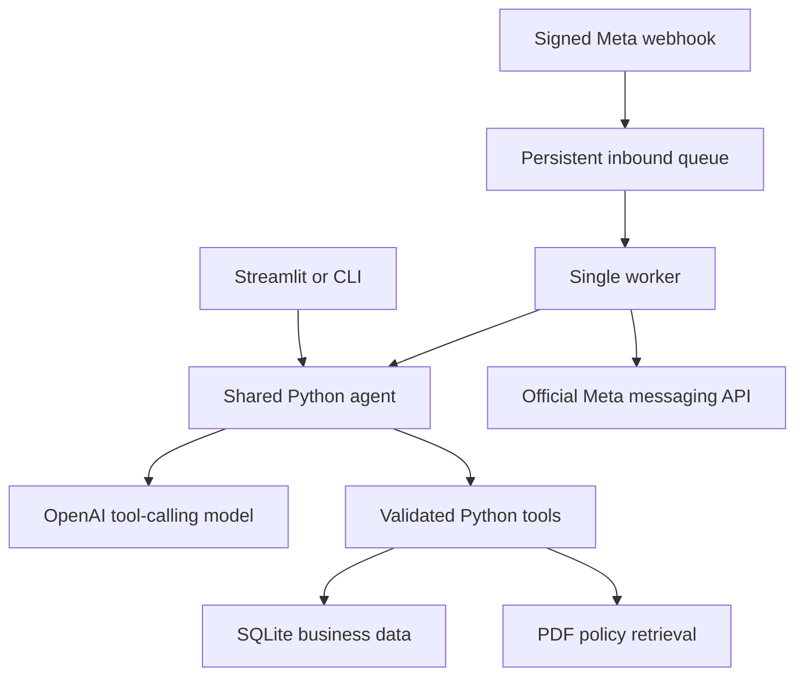

# Empório da Música — AI Customer Support Agent

**Project 23 · Artefact AI Engineer technical challenge**  
**Candidate:** Silas Maia de Oliveira  
**Repository:** https://github.com/silasmaia77/emporio-da-musica-projeto23

Mel is a Python-based generative AI assistant for a fictitious musical-instrument store in Campo Grande, Brazil. It helps customers discover instruments, check prices and availability, understand payment conditions, consult their orders and navigate store policies.

The implementation combines **LLM function calling, relational queries and document retrieval**. The local chat is the primary evaluation interface. An official Meta WhatsApp Cloud API adapter is included as an additional integration; a Meta account is not required to evaluate the local agent.

> **Validation scope:** 48 automated tests passed in the Python 3.10 build environment. The candidate subsequently reported a successful local conversation with the real model after configuration fixes. That observation is not a comprehensive live-model evaluation. Real WhatsApp delivery and Docker execution have not been validated. The included conversation examples are explicitly identified simulations.

## Contents

- [Challenge alignment](#challenge-alignment)
- [Architecture and technical decisions](#architecture-and-technical-decisions)
- [Install and run](#install-and-run)
- [Configuration](#configuration)
- [Data and policy retrieval](#data-and-policy-retrieval)
- [Business rules and assumptions](#business-rules-and-assumptions)
- [WhatsApp integration](#whatsapp-integration)
- [Testing and evaluation](#testing-and-evaluation)
- [Security and privacy](#security-and-privacy)
- [Troubleshooting](#troubleshooting)
- [Limitations and next steps](#limitations-and-next-steps)
- [AI assistance and development workflow](#ai-assistance-and-development-workflow)

## Challenge alignment

| Challenge requirement | Implementation / evidence |
|---|---|
| Python as the main language | Agent, ingestion, tools, pricing, API, worker and tests are written in Python. |
| A persona aligned with the store | Mel is a friendly, concise virtual assistant; customer-facing responses are in Brazilian Portuguese. |
| Answers grounded in the supplied context | Product/order tools query SQLite; policy retrieval reads the supplied PDF. |
| Distinguish operational data from policies | Separate typed tools for catalog/orders, calculations and document retrieval. |
| Handle out-of-scope questions | System instructions restrict the assistant to store services and redirect unrelated requests politely. This behavior requires real-model evaluation. |
| Explain approach, model, interface, history and data treatment | Documented below, with assumptions and trade-offs. |
| Describe limitations and future work | Explicitly documented; simulated and external integrations are distinguished. |
| Disclose coding-assistant use | Dedicated workflow and AI-assistance section. |
| Supply 3–5 varied conversations | Five transcripts in `examples/`; their model responses are scripted, with actual local tool execution. Live transcripts should be added for stronger evidence. |
| Public repository and incremental history | Public repository URL above; incremental commits retained through Git-history recovery. |

The implementation adds a Meta adapter, but does not make WhatsApp setup a prerequisite for the core challenge. Documentation is in English in accordance with the recruitment email; conversations target the Brazilian store audience.

## Architecture and technical decisions



### Agent approach: a small hybrid architecture

The LLM interprets requests, selects tools and writes the response. Python owns database access, customer authorization and monetary calculations. The model cannot execute arbitrary SQL, change the authenticated customer or select an arbitrary outbound WhatsApp recipient.

This separates three responsibilities:

1. **Structured facts:** parameterized SQL for products, stock, promotions and orders.
2. **Policies:** retrieval of relevant PDF passages, retaining section and physical page references.
3. **Conversation:** the LLM combines results into a contextual response.

The project uses the provider SDK directly instead of stacking several agent frameworks. For the challenge's limited scope, a compact tool loop is easier to inspect, debug and test. A multi-agent system or external vector database would add operational cost without a demonstrated requirement.

### Model and provider

The candidate's configured model is **`gpt-5.6-luna` through the OpenAI API**. The intended trade-off is a lightweight model for short, tool-backed support exchanges; this project does not claim a benchmark or measured cost advantage over other models.

The SDK uses Chat Completions. For `gpt-5.6-luna`, `src/agent/engine.py` explicitly sets **`reasoning_effort="none"`** when supplying function tools, addressing the API rejection observed during local setup. Other model IDs do not automatically receive this override.

The model ID, API key and base URL are configurable. An OpenAI-compatible endpoint can be configured, but compatibility of other providers/models must be evaluated separately. Provider timeout and retries are bounded, and each turn permits at most eight tool executions.

### Retrieval choice

The policy manual is small. The retriever uses accent normalization, lexical matching, domain aliases and heading-weighted scoring. Chunks retain source section and page information. This provides retrieval-augmented generation without hosted vector infrastructure or embedding costs.

The trade-off is weaker handling of unusual paraphrases and spelling errors than a well-evaluated semantic/hybrid retriever. Returned sources support inspection; retrieval is not proof that every generated sentence is correct.

### Prompt strategy

`src/agent/prompts.py` defines persona, scope, tool-use expectations, privacy boundaries and treatment of ambiguity. It instructs the model to:

- Introduce itself once, answer directly and avoid repetitive questionnaires.
- Re-query commercial facts rather than rely on conversational memory.
- Use calculation tools for prices and installments.
- Avoid invented products, unsupported discounts or fictitious actions.
- Ask for missing return information and distinguish estimated from actual delivery.
- Treat retrieved text as data, not instructions that override system behavior.
- Admit failures and refer unresolved policy cases to staff.

These are behavioral instructions, not absolute guarantees. Ownership checks, argument validation and pricing rules are enforced in code independently of prompt compliance.

### Interfaces and persistence

Streamlit provides the main demonstration chat, a simulated customer selector and a collapsible tool/source trace. CLI supports terminal evaluation. FastAPI handles Meta webhook requests.

SQLite persists business data, conversations, local support requests and queue jobs. Conversation history is isolated by session; Meta sessions additionally include the configured phone-number asset and sender. The model receives the latest 24 user/assistant messages. Changing a demo identity clears that session's previous context.

One worker is the supported Meta baseline. SQLite was selected for a reproducible local setup rather than production-scale concurrency.

## Install and run

### Prerequisites

- **Python 3.10**; tested with CPython 3.10.22 on Linux.
- A virtual environment and an API key authorized to use the configured model.
- Internet access for model calls.
- Git for repository operations.
- Optional: Docker Compose, VS Code/Jupyter support, or a Meta developer account.

Windows dependency resolution was checked, but automated runtime testing was performed on Linux. `tzdata` is explicitly included for Windows timezone support. Streamlit and ipykernel versions are pinned to Python 3.10-compatible releases.

### 1. Clone the repository

```powershell
git clone https://github.com/silasmaia77/emporio-da-musica-projeto23.git
cd emporio-da-musica-projeto23
```

If using an existing project folder or ZIP, open a terminal in the directory containing `app.py` and `requirements-dev.txt` instead.

### 2. Create and activate the environment

**Windows PowerShell:**

```powershell
py -3.10 -m venv .venv23
.\.venv23\Scripts\Activate.ps1
python -m pip install --upgrade pip
python -m pip install -r requirements-dev.txt
```

If PowerShell blocks activation, apply the policy only to the current terminal, then activate again:

```powershell
Set-ExecutionPolicy -Scope Process -ExecutionPolicy RemoteSigned
.\.venv23\Scripts\Activate.ps1
```

**Linux/macOS with Python 3.10 installed:**

```bash
python3.10 -m venv .venv23
source .venv23/bin/activate
python -m pip install --upgrade pip
python -m pip install -r requirements-dev.txt
```

`requirements.txt` contains runtime dependencies. `requirements-dev.txt` includes that file and adds testing/notebook dependencies; installing the development file is sufficient for the full evaluation workflow.

### 3. Configure the model

Copy the template **only when creating a new local configuration**:

```powershell
Copy-Item .env.example .env
```

On Linux/macOS, use `cp .env.example .env`. Do not overwrite an existing configured `.env`.

Edit the local `.env`:

```dotenv
OPENAI_API_KEY=YOUR_LOCAL_API_KEY
OPENAI_MODEL=gpt-5.6-luna
OPENAI_BASE_URL=https://api.openai.com/v1
ASSISTANT_NAME=Mel
DATABASE_PATH=data/processed/store.sqlite
APP_ENV=local
META_DRY_RUN=true
```

Replace the example key locally. **Never put a real key in `.env.example`, source code, screenshots or notebook outputs.** Meta credentials may remain empty when evaluating the local chat.

### 4. Import the data

Required sources:

```text
data/source/base_organizada.xlsx
data/source/politicas_da_loja.pdf
```

Run:

```powershell
python -m src.data.importer
```

### 5. Start the chat

```powershell
python -m streamlit run app.py --server.port 8523
```

Open **http://localhost:8523**. Try:

- `Olá! Quais violões disponíveis custam até R$ 1000?`
- `Quanto custa o Yamaha C40?` followed by `E no Pix?`
- `Qual o endereço e o horário de funcionamento?`
- `Comprei online e quero devolver. Como funciona?`

The UI also imports the source on initial startup. If data changes during a running session, explicitly reimport and restart as described below.

### CLI alternative

```powershell
python -m src.cli
python -m src.cli --demo-customer 3
```

Type `/sair` to exit. Demo customer 3 owns order 1; customer 18 owns multi-item order 15. The selector/CLI argument simulates a verified identity for evaluation; it is **not production authentication**.

### Docker alternative

With `.env` configured:

```bash
docker compose up --build
```

Compose runs the importer, UI, API and one worker against a named volume. Host ports bind to loopback. The worker needs LLM credentials even when Meta sending is simulated. Docker execution has not been validated in the build environment.

| Component | Local endpoint / resource |
|---|---|
| Streamlit | `http://localhost:8523` |
| Meta webhook API | `http://localhost:8023` |
| API health | `http://localhost:8023/health` |
| Webhook path | `/webhook` |
| Compose project | `emporio_musica_23` |
| Worker / SQLite | No listening port |

The numbered allocation identifies Project 23; it does not guarantee that no other application occupies these ports on another computer.

## Configuration

| Variable | Purpose |
|---|---|
| `OPENAI_API_KEY` | Local secret authorizing model calls. |
| `OPENAI_MODEL` | Model identifier, configured here as `gpt-5.6-luna`. |
| `OPENAI_BASE_URL` | Explicit SDK endpoint; use `https://api.openai.com/v1` for direct OpenAI access. |
| `ASSISTANT_NAME` | Configurable display persona; default Mel. |
| `DATABASE_PATH` | SQLite path; relative paths assume commands run from the project root. |
| `APP_ENV` | Environment label; not an authentication/security switch. |
| `META_DRY_RUN` | Defaults to true; records simulated outbound messages without calling Meta. |
| `META_ACCESS_TOKEN` | Secret authorizing outbound Meta requests. |
| `META_PHONE_NUMBER_ID` | WhatsApp phone-number asset ID, not its displayed telephone digits. |
| `META_WABA_ID` | Business account ID used to filter incoming events when configured. |
| `META_VERIFY_TOKEN` | Operator-defined GET webhook handshake token. |
| `META_APP_SECRET` | Secret used to verify raw-body HMAC signatures. |
| `META_GRAPH_API_VERSION` | Explicit supported Graph version selected in the operator's Meta dashboard. |
| `RUN_LIVE_LLM` | Opt-in switch for real model validation in the notebook/script. |
| `RUN_LIVE_META` | Opt-in switch for the separately confirmed real Meta test. |
| `LIVE_META_RECIPIENT` | Operator-selected destination for the optional live template test. |
| `LIVE_META_TEMPLATE_NAME` / `LIVE_META_TEMPLATE_LANGUAGE` | Actual approved template identifier and language. |
| `LIVE_META_TEMPLATE_APPROVED` | Operator confirmation; does not itself obtain approval from Meta. |

Environment variables already set in the shell take precedence over `.env`. Restart the relevant application processes after configuration changes; refreshing the browser is insufficient.

## Data and policy retrieval

The challenge originally describes CSV tables. This project uses the supplied organized workbook as an ingestion source, preserving the relational business entities rather than treating the spreadsheet as one unstructured document.

| Workbook tab | SQL table / role | Supplied records |
|---|---|---:|
| `categorias` | `categories` | 9 |
| `produtos` | `products` | 65 |
| `clientes` | `customers` | 50 |
| `pedidos` | `orders` | 20 |
| `itens_pedido` | `order_items` | 22 |
| `promocoes` | `promotions` | 25 |
| `instrucoes`, `pendencias`, `dicionario`, `catalogo_agente` | Supporting/source metadata | Retained in `source_aux` |

All ten workbook tabs are retained as provenance. Primary/foreign keys preserve these joins:

- Products → categories by `category_id`.
- Promotions → products by `product_id`.
- Orders → customers by `customer_id`.
- Order items → orders/products by `order_id` / `product_id`.

A live SQL view derives catalog information from the business tables. The copied `catalogo_agente` tab is not used as a competing authoritative catalog. Four source promotions are marked active.

Ingestion validates required columns, unique positive entity identifiers, JSON specifications and relational constraints. UPSERTs are transactional and repeatable. Money is converted to integer cents; calculations use Decimal and explicit rounding.

The PDF loader produces local passages with physical page/section references. Customer/order records are not indexed in policy retrieval. Original data-quality notes remain available; conflicting technical details are withheld from confident answers while unaffected price/stock facts remain usable.

### Tools

| Tool | Responsibility |
|---|---|
| `search_products` | Filter catalog by terms, category, list-price budget and availability. |
| `get_product_details` | Read a product's status, price and usable specifications. |
| `get_active_promotions` | Read promotions marked active in the system. |
| `calculate_payment_options` | Calculate discounts and installments for a selected product. |
| `get_order_status` | Return an order only for the backend-authorized customer. |
| `search_store_policies` | Retrieve source passages for institutional/procedural questions. |
| `create_support_request` | Persist a local support ticket; no external staff notification. |

Inputs are validated using Pydantic. SQL values are parameterized. Tool responses distinguish missing records, invalid arguments, authorization requirements and unresolved business rules.

### Updating data

1. Back up the existing database before reimporting operational changes.
2. Replace `data/source/base_organizada.xlsx`, preserving tab names, columns and identifiers.
3. Run `python -m src.data.importer`.
4. Restart the UI and any running worker/API processes to refresh cached application state.

Reimport does not duplicate matching IDs or erase conversations. It **does not delete records removed from the workbook**; removal requires an explicit migration. Mark a product `discontinued` when withdrawing it from sale. Reimport overwrites matching operational values with source values.

For policy changes, replace `data/source/politicas_da_loja.pdf` and restart the processes to clear cached PDF chunks. Source files are never edited by ingestion.

## Business rules and assumptions

| Topic | Implemented interpretation |
|---|---|
| Availability | Offer only `active` products with positive stock. `coming_soon` and `discontinued` are not available for sale. |
| Promotions | Apply only active flags; do not infer activation/expiration from campaign name or calendar month. |
| Pix | Apply 5% to list price only when no active promotion applies; discounts do not stack. |
| Multiple active promotions | Require confirmation instead of silently choosing a discount. |
| Installments | Specific policy bands take precedence: 4–6 installments require R$80 minimum per installment; 7–12 require R$100. Below-R$50 multi-installment purchases require clarification. |
| Rounding | Distribute cent remainders across installments so their sum equals the total. |
| Local shipping | Exact R$500 boundary is unspecified; request confirmation. Other-city shipping cannot be quoted without missing inputs/integration. |
| Returns | Ask for purchase channel and actual receipt date when absent; expected delivery is not receipt. No automatic refund execution. |
| Historical orders | Preserve the supplied total; do not reconstruct original unit prices using today's catalog. |
| Contacts | Distinguish remote WhatsApp in §7 from store telephone in §1.2; document the inconsistent email spelling. |
| Timezone | `America/Campo_Grande`; no verified holiday/special-hours calendar. |
| Source freshness | A challenge snapshot, not a synchronized ERP or carrier connection. `created_at` is product registration, not inventory refresh. |

The manual's broader catalog description is not a reason to invent products absent from the supplied data. The assistant sells instruments only and does not invent partner shops or accessory stock. See [assumptions](docs/assumptions.md) for the detailed rationale.

## WhatsApp integration

The optional adapter uses the **official Meta WhatsApp Cloud API**, not WhatsApp Web automation or an unofficial gateway. See [Meta setup](docs/meta_setup.md).

Start both processes in separate activated terminals:

```powershell
python -m uvicorn src.api:app --host 127.0.0.1 --port 8023
```

```powershell
python -m src.worker
```

The GET webhook validates the handshake token. The POST webhook authenticates the raw bytes using HMAC-SHA256, filters configured assets, separates status events from incoming messages and persists deduplicated message IDs before acknowledging reception. LLM processing does not delay webhook acknowledgement.

The worker enforces conversation ordering and sends replies to the trusted inbound sender. Queue states distinguish pending, processing, sending, sent, simulated, blocked, failed and uncertain outcomes. Failed/uncertain jobs require review before that conversation continues. Transient pre-send failures and rate limits have bounded retries.

Send timeouts/crashes can leave an unknown external delivery outcome. Such jobs are not blindly replayed; **exactly-once WhatsApp delivery is not claimed**. Free text is blocked outside the implemented 24-hour window from the triggering inbound message. The worker does not automatically select a template; approved-template sending is a separate explicit operator action.

Keep `META_DRY_RUN=true` for evaluation without external sends. Real operation requires credentials, the correct phone/WABA, supported Graph version, account permissions and an HTTPS callback under the operator's control. It cannot bypass Meta account restrictions or approval requirements.

## Testing and evaluation

### Automated tests

```powershell
python -m pytest -q
```

**Recorded build result:** 48 tests passed on CPython 3.10.22. The suite covers relational integrity, repeatable imports, searches, stock statuses, discounts, installment arithmetic, policy retrieval, ownership, session isolation, signed webhooks, deduplication, queue recovery, mocked outbound HTTP and the Luna tool-call configuration regression.

Tests use temporary databases, model test doubles and HTTP mocks. Passing them does not demonstrate real-model language compliance or live WhatsApp delivery. Recorded results are in `docs/test_results.txt`; earlier notebook reports may reflect the suite before the two Luna regression tests were added.

### Numbered Python validation blocks

```powershell
python notebooks/01_validacao_completa.py
```

Alternatively, open `notebooks/01_validacao_completa.ipynb` in VS Code/Jupyter and select the project's Python 3.10 environment. The paired `.py` contains **25 numbered `# %%` Python blocks** and is the notebook's source. Rebuild it with:

```powershell
python notebooks/build_notebook.py
```

The blocks cover environment/configuration, all workbook tabs, relationships, reimport, search, availability, pricing, policies, orders, authorization, memory, Meta handshake/signatures/events, queue recovery, mocked sending, window rules, integrated flow and failure handling.

In the build environment, notebook code was executed sequentially in-process because kernel sockets were unavailable. A local Jupyter-kernel run is a separate check. Reports are in `docs/validation_results.json` and `docs/notebook_script_results.txt`. Clear saved outputs before publishing if they contain local information.

### Optional live evaluation

Set `RUN_LIVE_LLM=true` to enable the real-model block with your own credentials. It performs tool-backed scenarios and follow-up checks. Outputs require manual review for correctness, tone and scope.

Real Meta testing additionally requires `RUN_LIVE_META=true`, `META_DRY_RUN=false`, recipient/template configuration and the exact interactive confirmation `SEND`. This sends one actual approved template. Outbound API acceptance does not prove inbound webhook delivery, customer receipt or read status.

| Validation area | Evidence / current boundary |
|---|---|
| Python 3.10 deterministic suite | 48 passing tests in the build environment. |
| Streamlit startup | AppTest startup passed on Python 3.10. |
| Numbered blocks | Local Python cells executed; optional external checks skipped during the build. |
| Real model | Candidate reported successful local operation after endpoint/tool-call fixes; formal multi-scenario evidence still needs to be captured. |
| Meta | Signed payload/HTTP integration tested with mocks; real delivery not verified. |
| Docker | Configuration supplied; image/Compose execution not verified. |

### Conversation examples

Five transcripts are supplied:

- [Catalog under a budget](examples/01_catalog.md).
- [Product price and Pix follow-up](examples/02_price_pix.md).
- [Address and opening hours](examples/03_store_policies.md).
- [Authorized multi-item order](examples/04_order.md).
- [Returns and accessory scope](examples/05_returns_scope.md).

These transcripts run actual local tools with a **scripted model test double**. They are not real LLM or WhatsApp transcripts. Regenerate them with `python examples/generate_examples.py` after installing development dependencies.

For the strongest challenge submission, replace or supplement the simulations with 3–5 actual agent conversations, including one that combines a real tool query with a policy decision. Do not label simulations as live results. See [evaluation](docs/evaluation.md) for the review rubric.

## Security and privacy

- `.env` must remain local; publish only `.env.example` with empty/example values.
- Exclude virtual environments, runtime databases, logs and recovery bundles from Git. Inspect the staged changes and commit history before publishing credentials-related files.
- Keep the demo identity selector local. Customer ID entered in chat is not authentication.
- Meta sessions remain anonymous until an operator establishes a trusted verified binding. No production OTP/login workflow is implemented.
- Order tools enforce ownership in SQL. The LLM cannot supply a different authorized customer ID.
- Customer/order data is excluded from the policy index, but authorized tool results can become model context. Use only the supplied fictitious records for the public challenge; a real deployment requires appropriate provider/data-processing controls.
- Logs and technical traces avoid secret values and raw personal tool arguments. SQLite conversation storage is not encrypted and has no automated retention policy.
- Prompt instructions address scope/injection, but only code-enforced authorization is a hard boundary; real-model adversarial testing remains necessary.

Use a backup before operational imports. Do not expose the local Streamlit UI as a production customer login.

## Troubleshooting

| Symptom | Check / resolution |
|---|---|
| Streamlit cannot install | Verify `python --version` is 3.10 and install the current project requirements. This project pins Streamlit 1.65.0 and ipykernel 7.3.0. |
| `UnsupportedProtocol` / URL missing scheme | Set `OPENAI_BASE_URL=https://api.openai.com/v1`. Check for overriding shell variables and restart the process. |
| Luna tools rejected with a reasoning error | Use the corrected `src/agent/engine.py`, which sends `reasoning_effort="none"` for this model. |
| Generic chat error | Inspect `agent_failure type=...` in the terminal; test with the same model and tool definitions. A plain text completion alone does not validate tools. Never paste a key into diagnostics. |
| `.env` changes appear ineffective | Stop and restart the application. Existing shell variables override file values. |
| Missing catalog/policies | Check the exact source filenames and run the importer from the project root. |
| Order unavailable | Select the proper simulated identity locally; production Meta sessions require verified backend identity. |
| Port already occupied | Stop the conflicting process or explicitly change the port and dependent callback/proxy configuration. |
| Meta accepts no messages | Check signature, phone/WABA filters and duplicate message IDs; status-only events do not create jobs. |
| Queue blocked/uncertain | Inspect the recorded state and reconcile delivery/configuration before retrying manually. |

## Limitations and next steps

1. **Model evaluation:** collect reproducible live conversations, tool-use accuracy and adversarial cases. No hallucination/latency/cost benchmark is claimed.
2. **Retrieval:** evaluate lexical misses before adding embeddings, hybrid ranking or a reranker.
3. **Identity and data protection:** add a real verification process, data minimization, retention, encryption and access auditing before using real customer records.
4. **Operational reliability:** add queue review/reconciliation tooling, leases with heartbeats and stronger multi-worker coordination before scaling.
5. **Commercial integrations:** no ERP synchronization, stock reservation, checkout, actual refunds or carrier tracking integration.
6. **Human handoff:** support tickets are local records; there is no external staff notification channel.
7. **Media and calendars:** text only, without audio/image understanding or a verified holiday/special-hours calendar.
8. **Deployment:** validate Docker and a real HTTPS Meta webhook end to end, plus account permissions and approved templates.
9. **History/context:** recent-turn persistence is bounded; longer sessions need evaluated summarization and a lifecycle policy.
10. **Data lifecycle:** source-row deletion is not automatically propagated to SQL; explicit migrations are required.

This is an inspectable technical prototype, not a claim of production readiness. Additional integrations are deliberately separate from the local evaluation path.

## Project layout

```text
app.py                       Streamlit chat
src/config.py                Environment settings
src/cli.py                   Terminal interface
src/api.py                   FastAPI webhook application
src/worker.py                Queue consumer and reply delivery
src/agent/                   Prompt, tool definitions and shared LLM engine
src/channels/                Official Meta HTTP/webhook/signature components
src/data/                    Importer, SQLite schema and repositories
src/policies/                PDF chunking and retrieval
src/services/                Pricing, session storage and persistent queue
data/source/                 Supplied workbook and policy PDF
data/processed/              Generated local database, not for publication
tests/                       Deterministic automated validation
notebooks/                   Paired Python script/notebook with 25 blocks
examples/                    Five explicitly simulated conversations
docs/                        Architecture, assumptions, evaluation and setup notes
.env.example                 Non-secret configuration template
requirements.txt             Runtime dependencies
requirements-dev.txt         Runtime plus tests/notebook dependencies
Dockerfile                   Python 3.10 container definition
docker-compose.yml           Importer, UI, API and one worker
```

## AI assistance and development workflow

**ChatGPT/Codex was used as a coding assistant** for requirements analysis, architecture discussion, implementation drafts, tests, documentation and troubleshooting. The candidate supplied the case materials, an existing project-organization reference, desired Python version, project numbering and integration requirements.

The workflow was iterative: inspect the challenge and sources; organize relational data; implement a shared agent/tool layer; add the Meta adapter; execute deterministic checks; adapt dependencies to Python 3.10; then use candidate-provided runtime diagnostics to resolve endpoint and Luna tool-call compatibility issues. Generated code was exercised with automated tests rather than treated as validated by generation alone.

The initial implementation commits use `Project Builder <builder@example.invalid>` to distinguish assisted build provenance from the candidate's later local commits. A portable Git bundle was used to recover the original incremental history after a damaged extracted `.git` directory was detected. Recovery preserved the existing commits; it did not fabricate backdated development history.

The candidate is responsible for reviewing and understanding the implementation and accurately reporting any further manual or live evaluation. This README does not claim unaided authorship or completed production validation.

## Submission notes

The repository is intended to meet the technical case's public-code deliverable. The recruitment email also requests an English PDF submitted through Google Forms. `docs/technical_summary.pdf` is a review draft; update its repository URL, recorded results and any remaining draft statements before using it as the final submission.

Keep real credentials out of every submitted artifact, include genuine interaction evidence and stop modifying the submitted repository after the delivery deadline specified by the selection process.
