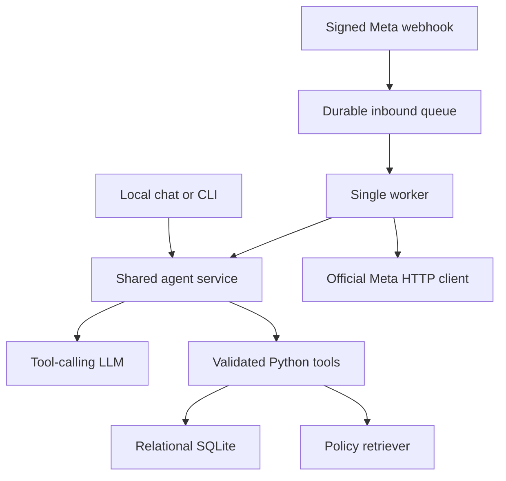

# Architecture

The webhook authenticates raw payloads before persisting. It never calls the LLM directly. The worker claims jobs using an immediate SQLite transaction and excludes conversations with unresolved earlier work. Conversation histories are keyed by channel/phone-number/sender. Meta identities remain anonymous unless an operator has stored a previously verified identity binding.

The LLM has no arbitrary SQL, outbound-recipient or authentication mutation tools. Pricing and ownership checks remain Python responsibilities. Retrieved PDF passages retain physical page numbers, which may differ from printed footer numbering. Technical traces expose tool names/status and source positions, not customer records.

Model context includes recent user/assistant turns; intermediate tool messages are per turn. This avoids orphaned tool-call history. At most eight tool executions and bounded provider timeouts prevent unbounded reasoning loops. Tool selection and natural-language adherence remain model behavior and require a live evaluation gate.

SQLite was selected for setup simplicity and inspectability, suitable for the prototype and one worker. Before scaling: move queue/locks to dedicated services, separate data ownership, add retention/encryption and real identity verification, implement dead-letter review and delivery reconciliation.
